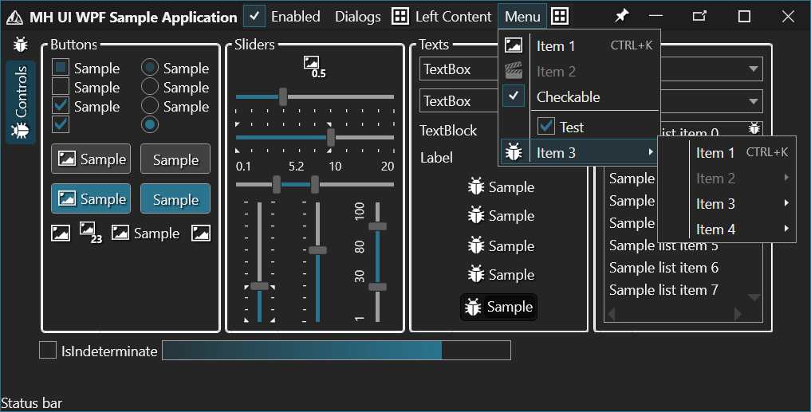

# MH.UI.WPF

**MH.UI.WPF** is the WPF implementation and presentation layer for [MH.UI](https://github.com/martin-holy/MH.UI). It connects platform-independent control logic to native WPF controls and provides reusable WPF components, styles, templates, converters, and utilities for building desktop applications.

The library targets .NET 8 for Windows and follows an MVVM-friendly design, integrating with WPF data binding, commands, dependency properties, and resource dictionaries.

## Highlights

- **WPF hosts for headless controls** — Native presentation and interaction for `CollectionView`, `TreeView`, `MediaPlayer`, `ZoomAndPan`, dialogs, and slide panels defined in `MH.UI`.
- **Virtualized collection presentation** — `CollectionViewHost` renders the shared collection model through a virtualized tree-based view, supporting different item templates, sizes, grouping, and view modes.
- **Tree and navigation controls** — WPF hosts for hierarchical views and menus, with selection, scrolling, item containers, and drag-and-drop integration.
- **Media playback** — A WPF media-player implementation connected to the shared playback logic, together with a control panel and video-frame capture support.
- **Zoom, pan, and layout panels** — Interactive zoom-and-pan hosting, slide-panel layouts, and specialized scrolling and virtualization components.
- **Reusable dialogs and windows** — WPF presentation for shared dialog workflows, plus custom window behavior and templates.
- **Consistent control styling** — Resource dictionaries with reusable styles and templates for buttons, icons, text controls, lists, menus, tabs, sliders, scroll viewers, and other common WPF controls.
- **WPF development utilities** — Value converters, attached properties, behaviors, extension methods, resource management, and imaging helpers.

## Controls

### Collection and tree views

- `CollectionViewHost` — WPF presentation host for `MH.UI`'s `CollectionView`. Connects the virtualized collection model to WPF item containers, templates, scrolling, and group presentation.
- `TreeViewHost` — WPF host for the shared `TreeView` logic, providing item presentation, selection, scrolling, and tree interaction.
- `CatTreeView` — Specialized tree view for category-oriented navigation.
- `TreeMenuHost` — Presents hierarchical menu data using WPF controls and item-container styles.
- `VirtualizingSingleItemScrollStackPanel` — Virtualizing panel designed for layouts where each item occupies an individual scrolling position.

### Media, navigation, and layout

- `MediaPlayer` — WPF implementation of `IUiMediaPlayer`, connecting the shared media-player logic to WPF media playback.
- `VideoFrameSaver` — Captures video frames through WPF media infrastructure and implements the shared `IVideoFrameSaver` contract.
- `ZoomAndPanHost` — WPF host for shared zoom-and-pan behavior, including viewport interaction and animation.
- `SlidePanelHost` / `SlidePanelsGridHost` — Present shared slide panels as content and grid-based layouts.
- `RangeSlider` — Range-selection control with two adjustable values.
- `PopupSlider` — Slider with a popup-based value interaction.
- `CalendarExt` — Extended WPF calendar control.

### Windows and dialogs

- `CustomWindow` — Customizable WPF window with reusable window styling and behavior.
- `DialogHost` — WPF integration for the platform-independent dialog workflows defined in `MH.UI`.

### Icons and buttons

- `IconTextBlock` — Combines icon and text presentation with configurable layout and visual effects.
- `IconButton` / `IconTextButton` — Buttons with icon-only or combined icon-and-text content.
- `IconToggleButton` — Toggle button with icon presentation.
- `SlimButton` — Compact button style for space-efficient interfaces.
- `IconTextBlockItemsControl` — Items control for collections of icon-and-text elements.

## Styles, templates, and resources

The library includes resource dictionaries for common WPF controls and application UI elements. They provide consistent visual styles and control templates for buttons, check boxes, combo boxes, lists, menus, tabs, text controls, sliders, scroll bars, progress bars, tooltips, borders, and other standard components.

Additional data templates cover common application models such as `IListItem`, named objects, and log items. Dialog templates provide WPF presentations for the shared message, input, selection, grouping, progress, and toggle dialogs.

`Dictionaries` provides access to the library's resource dictionaries, while `CachedResourceDictionary` supports resource dictionary caching.

## Binding and UI integration

- **Attached properties** — Reusable properties for button configuration, icons, text handling, and content slots.
- **KeyboardFocus** — Behavior for managing keyboard focus in WPF interfaces.
- **Value converters** — Common and specialized converters for visibility, boolean values, equality, numeric calculations, grid lengths, docking, icons, resources, tree margins, tab sizing, and collection-view presentation.
- **CultureAwareBinding** — Binding implementation with culture-aware value conversion.
- **DataTemplate selectors** — Select templates based on runtime data types and flat-tree item types.
- **WPF extensions** — Helpers for dependency objects, framework elements, geometry types, bitmap sources, and bitmap metadata.
- **Imaging utilities** — Bitmap creation, conversion, and image-related helpers.
- **Drag-and-drop utilities** — Shared WPF helpers for drag-and-drop operations.
- **Color utilities** — Helpers for working with WPF colors.

## Dependencies and platform integration

MH.UI.WPF builds on [MH.UI](https://github.com/martin-holy/MH.UI) for platform-independent controls, dialogs, and interaction logic, and [MH.Utils](https://github.com/martin-holy/MH.Utils) for shared MVVM, binding, collection, and utility infrastructure.

WPF-specific hosts implement the platform interfaces exposed by `MH.UI`, while resource dictionaries and control templates provide the actual visual presentation. This keeps reusable control behavior separate from its WPF implementation.

## Installation

MH.UI.WPF is available as the `MH.UI.WPF` NuGet package.

- NuGet: [MH.UI.WPF](https://www.nuget.org/packages/MH.UI.WPF)